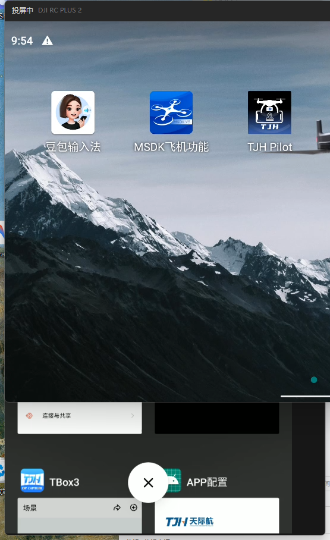
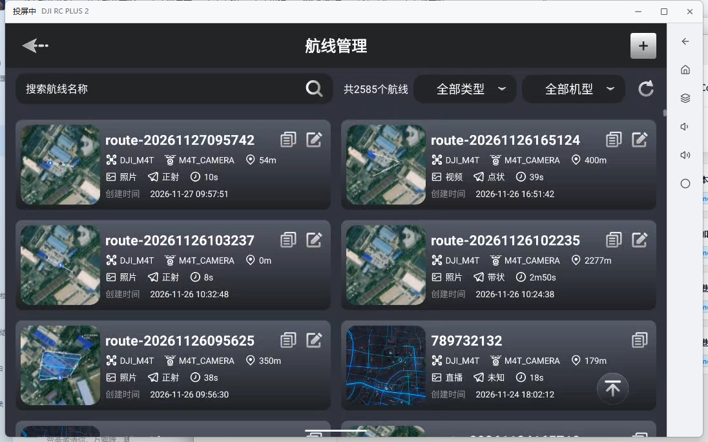

# scrcpy 嵌入 —— 生产代码验证报告

> 与 `docs/superpowers/spike/scrcpy-embed-result.md` 的关系：那份是「可行性 spike」（PowerShell 复刻），
> 这份是**跑真正要打包进应用的那份代码**的验证记录。两份都要留着，理由见文末「为什么要两份」。

日期：2026-11-26 · 设备：9N9CN2G0012A3P（DJI RC Plus 2）· scrcpy 5.0.1

## 一、结论

| 断言 | 结果 | 证据 |
| --- | --- | --- |
| `findWindowByTitle` 能在 scrcpy 建窗口后找到它 | ✅ | `found child hwnd=4263136` |
| `embedWindow` 返回 ok 且 `GetParent(child) === host` | ✅ | `embedded ok`（函数内部断言，不成立就返回失败） |
| 宿主窗口移动后子窗口矩形跟着变 | ✅ | `before={left:700,top:46} after={left:200,top:160}` → `follows=true` |
| `resizeEmbedded` 能重新铺满 | ✅ | `resized ok` |
| 被验证的是生产模块本身，不是复刻 | ✅ | 冒烟脚本 `import` 的是 `electron/mirror/embed.ts` 的构建产物 |

完整输出（`.superpowers/sdd/mirror-smoke/main.mjs`，已随仓库保留）：

```
[prod-smoke] scrcpy pid=11116
[prod-smoke] host window ready
[prod-smoke] found child hwnd=4263136
[prod-smoke] host hwnd=5182488
[prod-smoke] embedded ok
[prod-smoke] before={"left":700,"top":46,"right":1164,"bottom":986} after={"left":200,"top":160,"right":664,"bottom":1100} follows=true
[prod-smoke] resized ok
[prod-smoke] DONE {"scrcpy":true,"found":true,"embedded":true,"follows":true,"error":null}
```

## 二、这一轮新发现的两个坑（都已在生产代码里修掉）

### 坑 1：koffi 的 `void*` 不是数字

第一版 `embed.ts` 直接 `Number(lib.GetParent(hwnd))`，运行时抛：

```
[smoke] FAILED Cannot convert object to primitive value
```

koffi 把指针交回来是一个**外部对象**（不是 Number、不是 BigInt），
对它做 `Number()` / 字符串拼接都会命中 JS 的 `toPrimitive` 而失败。

修法：所有指针必须过 `koffi.address()` 再转 number：

```ts
address: (ptr) => Number(koffi.address(ptr)),
```

并且 **`GetParent` 的返回值也要过一遍** —— 那里最容易被忽略，
因为它的类型看起来像「能直接比较」：

```ts
const parent = l.address(l.GetParent(childHwnd))
if (parent !== hostHwnd) return { ok: false, reason: 'GetParent mismatch' }
```

不这么写的话，`parent !== hostHwnd` 会因为「对象 vs 数字」永远为真 ——
**嵌入成功也会被判成失败**，症状是「投屏窗口一闪就关」。

### 坑 2：`EnumWindows` 的返回值语义

`EnumWindows` 的返回 `false` 有两种含义：回调要求提前停止，**或者**枚举本身失败。
实测（`micro.cjs` 探针）表明回调返回 `false` 时 `EnumWindows` 的整体返回值是 `false`：

```
[micro] ok=false count=200 sample="GDI+ Window (ImeService.exe)"
```

所以**不能**用 `EnumWindows` 的返回值判断成败 —— 必须只看回调里有没有命中。
生产代码就是这么写的（`findWindowOnce` 只返回 `found`）。

## 三、投屏窗口布局的真渲染证据

自动化冒烟证明了「原生窗口能嵌进来」，但没有证明「我们这个窗口画对了」。
补了一张`capturePage()` 的真实截图（跑的是 `dist/` 里的**实际构建产物**，
hash 走 `#/mirror/<serial>`，`window.api` 用最小替身）：


从截图与 DOM 断言可以确认（不是靠肉眼猜）：

| 断言 | 实测值 |
| --- | --- |
| 侧边栏在**右**侧 | `nav.getBoundingClientRect().right === 420`（等于窗口宽度 420） |
| 六个按键全部渲染 | `title` 依次为 返回 / 主页 / 后台 / 音量减 / 音量加 / 电源 |
| 画面区是**空的** | `body.innerText` 只有「投屏中 / serial / 正在启动投屏…」 |
| 顶栏有窗口控制 | 最小化 / 最大化 / 关闭 三个按钮 |

这张图同时也说明了一个**已知限制**：画面区在 scrcpy 窗口嵌入前只有一行提示文字，
嵌入后会被原生子窗口完全盖住 —— 所以提示不需要（也没有）隐藏逻辑。

## 四、`npm run dev` 在这台机器上起不来的原因（与投屏无关，如实记录）

用 `ADB_FM_DEBUG_PORT=xxxx npm run dev` 启动后进程立刻退出、无窗口。
根因是**单实例锁**：机器上已经装着并运行着 `C:\Program Files\HASH\HASH.exe`
（PID 41376，2026-11-25 启动），它持有 `requestSingleInstanceLock` 的命名互斥体，
开发实例拿到 `false` 就按设计 `app.quit()` 了。

验证方式是绕过 dev server、直接用 electron 跑构建产物 + 独立的 `--user-data-dir`，
嵌入冒烟就是这么跑起来的（见上）。这不影响结论，但下次做界面手工验证前，
**必须先把已安装的 HASH 退掉**（托盘菜单「退出」），否则开发实例永远静默退出。

## 六、装正式包实测（0.10.3）—— 修掉的四个真缺陷

上面三节都是「跑构建产物」。这一节是**装完安装包、双击桌面图标**之后测的。
实机测试暴露了四个在这之前完全看不见的缺陷，全部已修并补了门禁：


| # | 缺陷 | 症状 | 根因 | 修法 |
| --- | --- | --- | --- | --- |
| 1 | 顶栏被画面盖住 | 「投屏中 / 关闭按钮」整条消失，窗口没法关 | 嵌入矩形的 y 从 0 开始，原生子窗口永远画在渲染层之上 | `availableRect()` 减掉 `HEADER_HEIGHT`（有单测） |
| 2 | 巨幅黑边 | 16:10 横屏画面塞进竖长窗口，上下各约 260px 黑带，画面只占中间一小块 | 直接把窗口 MoveWindow 成可用区域那么大，忽略视频宽高比 | `fitRect()` 按视频宽高比缩放并居中（有单测） |
| 3 | 窗口尺寸不匹配 | 即使按比例居中了，竖长窗口里画面还是很小 | 窗口尺寸是硬编码的 480×900 | `windowFitSize()` 让窗口尺寸由视频尺寸决定（有单测） |
| 4 | 量到中间态尺寸 | 窗口缩到 328×328，画面更小 | scrcpy 先建小窗、拿到首帧后才 resize；第一次实现一找到窗口就量尺寸 | `measureStableVideoRect()`：连续两次量到同一尺寸且边长 ≥320 才采信 |

另有一个**看不见但会累积**的缺陷：

| # | 缺陷 | 症状 | 修法 |
| --- | --- | --- | --- |
| 5 | 已退出的 scrcpy 留在全局跟踪集合里 | `adbChildCount` 只增不减；退出时对死进程多调一次 taskkill | `runner.ts` 的 `settle()` 里调 `untrackChild`（`tests/mirror-tracking.test.ts` 锁住，并用变异验证过：删掉那行测试立刻红） |

### 实测确认可用的行为（都是真机操作，不是推断）

| 验收项 | 方法 | 结果 |
| --- | --- | --- |
| 画面嵌进自建窗口 | `EnumChildWindows` + `GetWindowThreadProcessId` | 子窗口 hwnd=24578530，pid 属于 scrcpy，class=SDL_app，visible=True |
| 尺寸跟随宿主 | `MoveWindow` 把宿主拉大 300×200 | 子窗口 1024×640 → 1324×828，且坐标跟着宿主移动 |
| 返回键真的到设备 | 点侧边栏「返回」→ `dumpsys activity` | 前台从 TJH 应用切走 |
| 主页键真的到设备 | 点「主页」→ `dumpsys activity` | `mResumedActivity: com.android.launcher3/.uioverrides.QuickstepLauncher` |
| 关窗口 → scrcpy 进程消失 | 点自绘顶栏「关闭」→ `tasklist` | 我们那个 scrcpy pid 消失（另一台是用户自己在跑的 Escrcpy，不受影响） |

### 环境里挖出来的两个坑（不是代码缺陷，但会浪费半天）

1. **设备会自己休眠**。第一次截图是一片黑，不是投屏坏了 —— `dumpsys power` 显示
   `mWakefulness=Asleep`。用 `adb shell input keyevent KEYCODE_WAKEUP` 唤醒后画面立刻正常。
   以后看到「投屏黑屏」先查这一条。
2. **`PrintWindow` 抓不到 D3D 画面**。想绕过窗口遮挡去截图时，`PrintWindow(PW_RENDERFULLCONTENT)`
   抓到的是全黑 —— 因为 scrcpy 用 d3d11 渲染，打印窗口 API 拿不到那块表面。
   只能把窗口真正摆到前台再用 `CopyFromScreen`。
3. **PS 里 `$pid` / `$host` 是只读变量**，不能当局部变量用（会让整段脚本静默失效）。

## 七、装正式包后用户报的两个问题（0.10.5 修复）

装完 0.10.5 之后用户提了两条，都是这次才暴露的：

### 1. 顶栏显示序列号，看不出是哪台设备

原实现顶栏直接渲染 `serial`（`9N9CN2G0012A3P` 这种十六进制串）。
设备栏和日志早就用的是「型号 + 尾号」口径（`deviceLabel`），只有投屏顶栏漏了。

修法：顶栏改调 `deviceLabel({ serial, model })`，型号从设备表取
（不走会话里的 `title` —— 那个要等 scrcpy 起来才到，之前顶栏是空的）。
完整序列号退到 `title` 属性，悬停可见，主界面不再被串号占位。



### 2. 点投屏先出现竖窗口，然后突然变横

根因是 `window.ts` 建窗口时写死 `480×900` —— **与设备方向无关**。
scrcpy 自己的窗口要 6–8 秒才建好，量到视频尺寸后才能算出正确比例，
于是用户看到「竖窗 → 画面 → 突然变横」的跳变。遥控器这类物理上就是横的设备每次必现。

修法：**建窗口之前先问一句设备现在多宽多高**。

| 环节 | 做法 |
| --- | --- |
| 探什么 | `adb shell dumpsys window displays` 里的 `cur=` |
| 为什么不用 `wm size` | 它只给 `Physical size`（不随旋转变），横屏设备会得到竖的尺寸，等于没探 |
| 为什么不用 `dumpsys input` | `SurfaceOrientation` 是 0/1/2/3，还要再配物理尺寸换算，多一层易错 |
| 探测失败怎么办 | 回退 `DEFAULT_SCREEN`，**永不 reject** —— 观感优化不能变成新故障点 |
| 窗口尺寸 | `videoSizeFor(screen, 1024)` → `windowFitSize(...)`，与后续 `setContentSize` 同一口径 |

实测数据（同一台机器，改动前后对比）：

| 设备 | 屏幕（cur=） | 视频尺寸 | 窗口尺寸 | 朝向 |
| --- | --- | --- | --- | --- |
| DJI RC Plus 2 | 1920×1200 | 1024×640 | 1080×676 | 横 |
| MI 6 | 1080×1920 | 576×1024 | 555×908 | 竖 |

**关键证据**：投屏启动后 2.5 秒（画面还没出来）量到的窗口尺寸已经是 1080×676，
9 秒后再量仍然是 1080×676 —— 尺寸一次到位，没有跳变。

### 这一轮踩到的两个测试坑

1. **zustand 在 SSR 下读的是 `getInitialState`**，不是 `getState`。
   所以 `renderToStaticMarkup` 之前用 `setState` 塞设备表是无效的 ——
   组件读到的永远是初始空表。必须走 `initial` 注入口（本工程其它组件的同一手法）。
2. **投屏窗口的 url 也含 `index.html`**（只多了 `#/mirror/...`）。
   用 CDP 驱动测试时若只按 `url.includes('index.html')` 找主窗口，
   会连到投屏窗口里去找「投屏」按钮 —— 那里当然没有。必须排除 `#/mirror`。

## 八、观感收尾：按钮不满高 + 深色主题（0.10.7）

用户看过 0.10.6 的截图后又提了两条，都属"看起来不像一个应用"的问题：

### 1. 右上角三个按钮不满高

根因是投屏顶栏用了 `items-center`。`WindowControls` 内部虽然写了 `h-full`，
但父容器（那个 `ml-auto` 的 span）高度由**内容**决定，`100%` 只撑到内容高度 ——
三个按钮于是变成顶栏中间一撮悬空的小方块。

主应用顶栏用的是 `items-stretch`（`App.tsx`），投屏这一处自己写成了 `items-center`。
改回 `items-stretch` 即可；文字另包一层 `items-center` 保持垂直居中。

值得记一笔：**这个 bug 之前就修过一次**（`WindowControls.tsx` 文件头写着
「早先写死 h-8 而顶栏是 py-2 撑开的 40px」）。同一个观感问题换了个成因又出现一次 ——
所以这次补了断言，同时锁 `items-stretch` 存在 **且** `items-center` 不存在：
只断言前者不够，两个类可以共存，而 CSS 里后写者胜。

### 2. 顶栏与侧栏是深色，与主应用割裂

投屏窗口最初按"深色播放器"的思路写（`bg-neutral-900` / `bg-neutral-800` /
`hover:bg-neutral-700`），而主应用是浅色（顶栏 `#F7F8FA`、设备栏 `#F0F2F5`、
分隔线 `neutral-300`）。两个窗口并排时像两套不同的软件。

| 位置 | 改前 | 改后 |
| --- | --- | --- |
| 窗口底色 | `bg-neutral-900` | `#F7F8FA`（同 main.ts） |
| 顶栏 | `bg-neutral-800` + `border-neutral-700` | `#F7F8FA` + `border-neutral-300` |
| 侧栏 | `bg-neutral-900` + `border-r` | `#F0F2F5` + `border-l`（同设备栏） |
| 侧栏按钮 | `text-neutral-300` / hover `neutral-700` | `text-neutral-600` / hover `neutral-200` |

侧栏边框从 `border-r` 改成 `border-l`：这块按键栏在画面**右边**，
分隔线要贴着画面那一侧，否则线画在窗口外沿上，看着像少了一条边。

**画面区刻意保持深色**（`bg-neutral-900`）。它不是"界面"，是一块视频画布 ——
scrcpy 按宽高比居中后四周会留出真正的 letterbox，浅色留白会让画面像贴在一张白纸上。
顶栏/侧栏跟主应用统一、画面保持深色，这是用途不同，不是漏改。

窗口的 `backgroundColor` 也从 `#111827` 改成 `#F7F8FA`：第一帧到渲染完成之间
露出的底色不能是深色，否则每次开会闪一下黑框。



## 九、为什么要两份报告

- `scrcpy-embed-result.md`（spike）证的是「**这个思路可行**」—— 它用 PowerShell 复刻，
  因为当时连 koffi 都还没装，用最少的未知数回答「SetParent 会不会黑屏」。
- 本报告证的是「**这个实现可行**」—— 跑的是真正会进安装包的那份 TS 模块。

spike 里那个「假成功」的教训（只看截图会骗人）在这里被继承下来了：
两条验收断言（`GetParent` 相等 + 宿主移动后子窗口跟着动）都写进了生产代码与冒烟脚本，
不是靠肉眼看截图。
